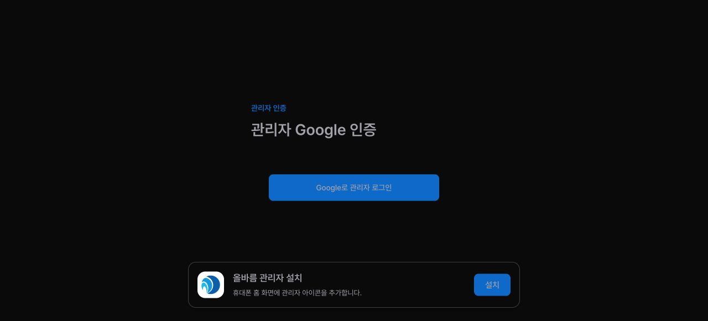

# 화면설명서

## 목차

1. [관리자인증](#manager-auth)

## 1. 관리자인증 {#manager-auth}

관리자 페이지에 들어가기 전에 Google 계정으로 본인 확인을 하는 화면입니다. 관리자 권한이 등록된 Google 계정으로 인증하면 관리자 메인 화면으로 이동합니다. 등록되지 않은 계정으로 인증하면 관리자 권한이 없다는 안내가 표시됩니다.

| 버튼 | 기능 |
| --- | --- |
| Google로 관리자 로그인 | Google 로그인으로 이동합니다. 관리자 권한이 등록된 Google 계정을 선택해 인증합니다. |
| 설치 | 하단에 **올바름 관리자 설치** 안내가 표시될 때 사용할 수 있습니다. 브라우저의 설치 확인창을 열어 관리자 앱 아이콘을 기기에 추가할 수 있습니다. |

[관리자 인증 화면 열기](https://www.olbareum.com/manager/auth?next=%2Fmanager)
