# 화면설명서

## 목차

1. [관리자인증](#manager-auth)
2. [대시보드](#manager-dashboard)
3. [월별상세현황](#manager-monthly-information)
4. [직원관리](#manager-employee-employees)
   - [4-1. 직원등록](#manager-employee-register)
5. [근무지관리](#manager-employee-worksites)
   - [5-1. 근무지등록](#manager-worksite-register)
6. [근무지배정](#manager-employee-assignments)
   - [6-1. 배정등록](#manager-assignment-register)
7. [공휴일관리](#manager-employee-holidays)
   - [7-1. 휴일추가](#manager-holiday-register)
8. [근태관리](#manager-reports-attendance)
9. [휴가관리](#manager-leave)
   - [9-1. 휴가신청](#manager-leave-register)
10. [월간근태](#manager-worker-information)
11. [점검지관리](#manager-inspection-sites)
   - [11-1. 점검지 등록](#manager-inspection-register)
12. [점검지점검현황](#manager-inspection-logs)
13. [특이사항](#manager-inspection-special-remarks)
14. [교육자료관리](#manager-safety-resources)
   - [14-1. 교재등록](#manager-resource-register)
15. [일일교육이수](#manager-safety-daily-edu)
16. [월별교육이수](#manager-safety-monthly-edu)
17. [관리자관리](#manager-system-admin-users)
   - [17-1. 관리자등록](#manager-admin-register)
18. [시스템설정](#manager-system-configs)
   - [18-1. 시스템설정 등록](#manager-config-register)
19. [자료관리](#manager-system-data-manage)

## 1. 관리자인증 {#manager-auth}

관리자 페이지에 들어가기 전에 Google 계정으로 본인 확인을 하는 화면입니다. 관리자 권한이 등록된 Google 계정으로 인증하면 관리자 메인 화면으로 이동합니다. 등록되지 않은 계정으로 인증하면 관리자 권한이 없다는 안내가 표시됩니다.

| 버튼 | 기능 |
| --- | --- |
| Google로 관리자 로그인 | Google 로그인으로 이동합니다. 관리자 권한이 등록된 Google 계정을 선택해 인증합니다. |
| 설치 | 하단에 **올바름 관리자 설치** 안내가 표시될 때 사용할 수 있습니다. 브라우저의 설치 확인창을 열어 관리자 앱 아이콘을 기기에 추가할 수 있습니다. |

[관리자 인증 화면 열기](https://www.olbareum.com/manager/auth?next=%2Fmanager)

## 2. 대시보드 {#manager-dashboard}

관리자 로그인 후 처음 표시되는 대시보드입니다. 출퇴근, 재직 인원, 안전교육, 특이사항과 휴가·점검 현황을 한눈에 확인할 수 있습니다. 캡처는 운영 요약과 왼쪽 메뉴 일부를 보여 줍니다. 화면에 표시된 수치는 테스트 데이터입니다.

### 조회 기준과 표시 내용

조회 조건을 입력할 필요 없이 화면을 열면 자동으로 현황을 불러옵니다.

| 항목 | 표시 내용 |
| --- | --- |
| 출근현황 | 오늘의 대기, 출근, 지각, 결근, 퇴근, 조퇴, 미퇴근, 휴가 인원과 총인원 |
| 직군별 인원배정 | 재직 직원의 직군별 인원과 일반·격일·야간 근무형태별 인원 |
| 안전교육 월별이수율 | 이번 달 안전교육 이수율과 이수·미이수 건수 |
| 미처리 특이사항 | 아직 처리되지 않은 특이사항 건수 |
| 금주 휴가현황 | 이번 주 휴가 일정의 이름, 직군, 근무형태, 휴가종류, 휴가기간, 근무지, 배정기간 |
| 점검지 점검 현황 | 근무지별 출근 인원/배정 인원과 전체 점검지 중 점검을 마친 비율 |

### 화면 링크

| 클릭하는 항목 | 이동하는 화면 |
| --- | --- |
| 출근현황 카드 | 근태관리 |
| 직군별 인원배정 카드 | 직원관리 |
| 안전교육 월별이수율 카드 | 월별교육이수 |
| 미처리 특이사항 카드 | 특이사항 |
| 금주 휴가현황의 전체보기 또는 직원 이름 | 휴가관리 |
| 점검지 점검 현황의 근무지명 | 점검지관리 |
| 왼쪽 메뉴 | 개요, 직원관리, 근태관리, 점검지점검, 안전교육, 시스템의 각 업무 화면 |

### 버튼

| 버튼 | 기능 |
| --- | --- |
| 관리자 메뉴 열기 또는 접기 / 관리자 사이드바 접기 또는 펼치기 | 왼쪽 관리자 메뉴를 열거나 접습니다. |
| 사용자 메뉴 | 화면 오른쪽 위의 계정 아이콘을 누르면 **로그아웃** 항목이 열립니다. |
| 로그아웃 | 현재 관리자 세션을 종료합니다. |

[관리자 메인 화면 열기](https://ollbareun.vercel.app/manager)

## 3. 월별상세현황 {#manager-monthly-information}

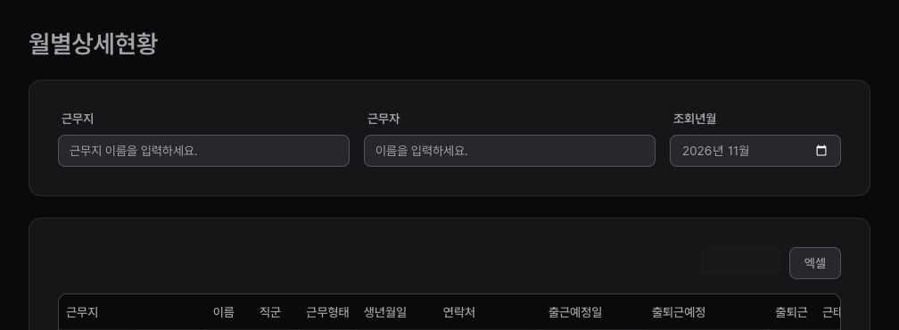

근무지와 직원 기본정보, 출퇴근 예정·실제 시각, 근태 상태, 교육 이수 및 특이사항을 한 표에서 확인합니다.

- **조회 조건** 근무지, 근무자, 조회년월.
- **화면 링크** 출근예정일은 근태 상세를, 특이사항 링크는 해당 보고 상세를 엽니다.
- **버튼과 조작** 엑셀은 조회 결과를 내려받습니다.

[월별상세현황 화면 열기](https://ollbareun.vercel.app/manager/monthly-information)

## 4. 직원관리 {#manager-employee-employees}

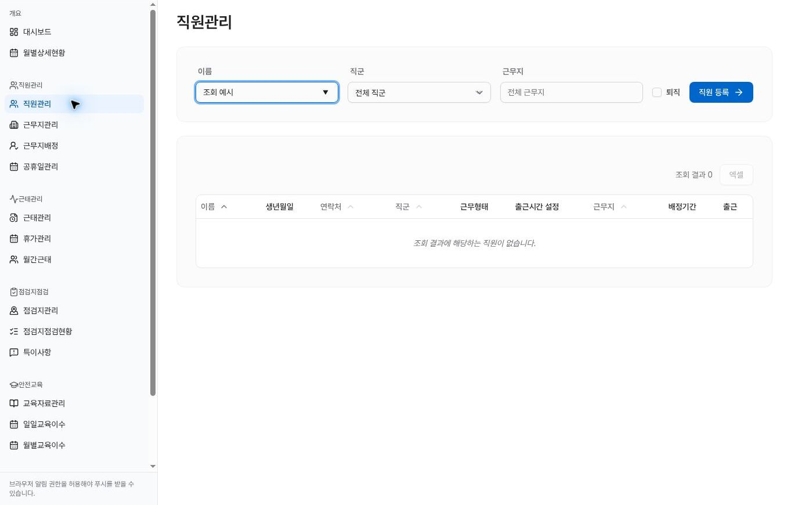

직원을 조회하고 기본정보, 근무지 배정, 출근 상태를 확인하는 화면입니다.

### 조회 조건과 표시 내용

| 항목 | 설명 |
| --- | --- |
| 이름 | 직원 이름으로 목록을 좁힙니다. |
| 직군 | 선택한 직군의 직원을 조회합니다. |
| 근무지 | 선택한 근무지에 배정된 직원을 조회합니다. |
| 퇴직 | 체크하면 퇴직 직원과 퇴직일을 표시합니다. 체크를 해제하면 재직 직원을 표시합니다. |
| 조회 결과 | 이름, 생년월일, 연락처, 직군, 근무형태, 출근시간 설정, 근무지, 배정기간과 출근 상태를 표시합니다. |

### 화면 링크

| 항목 | 기능 |
| --- | --- |
| 직원 이름 | 직원 상세를 엽니다. |
| 배정기간 | 해당 직원의 근무지 배정 상세를 엽니다. |

### 버튼

| 버튼 | 기능 |
| --- | --- |
| [직원 등록](#manager-employee-register) | 신규 직원 등록 창을 엽니다. |
| 정렬 화살표 | 이름, 연락처, 직군 또는 근무지를 기준으로 정렬 방향을 바꿉니다. |
| 엑셀 | 현재 조회 결과를 엑셀 파일로 내려받습니다. |

[직원관리 화면 열기](https://ollbareun.vercel.app/manager/employee/employees)

### 4-1. 직원등록 {#manager-employee-register}

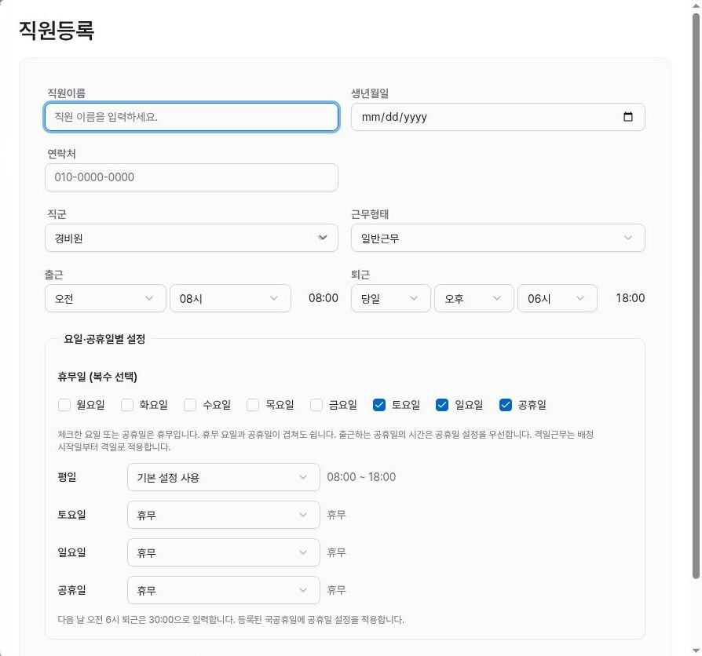

**직원관리** 화면에서 **직원 등록** 버튼을 누르면 열립니다.

| 항목 | 입력 또는 동작 |
| --- | --- |
| 직원이름, 생년월일, 연락처 | 직원의 기본정보를 입력합니다. |
| 직군 | 등록된 직군 중 해당 직군을 선택합니다. |
| 근무형태 | 일반근무, 격일근무, 야간근무 중 선택합니다. |
| 출근·퇴근 | 오전·오후와 시각을 선택합니다. 격일·야간근무는 익일 퇴근을 지정할 수 있습니다. |
| 근무 일정 | 근무형태에 맞춰 화면에 표시되는 일정 규칙을 설정합니다. |
| 저장 | 입력 내용을 확인하고 등록합니다. |
| 닫기 | 등록 창을 닫습니다. |

## 5. 근무지관리 {#manager-employee-worksites}

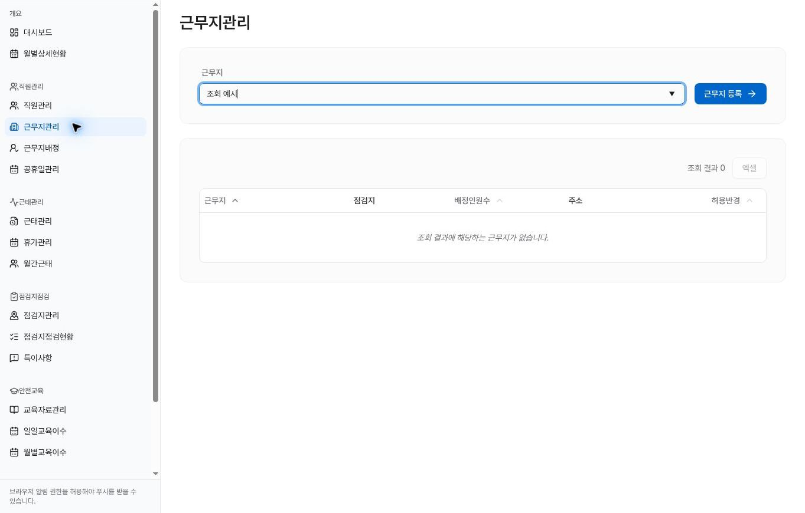

등록된 근무지를 조회하고 주소, 출퇴근 허용반경과 인원 배정 현황을 확인하는 화면입니다.

### 조회 조건과 표시 내용

| 항목 | 설명 |
| --- | --- |
| 근무지 | 이름을 입력해 목록을 좁힙니다. |
| 조회 결과 | 근무지 이름, 점검지 수, 배정인원수, 주소와 출퇴근 허용반경을 표시합니다. |

### 화면 링크

| 항목 | 기능 |
| --- | --- |
| 근무지 이름 | 근무지 상세를 엽니다. |
| 점검지 수 | 해당 근무지의 점검지관리 화면으로 이동합니다. |
| 배정인원수 | 해당 근무지의 근무지배정 화면으로 이동합니다. |

### 버튼

| 버튼 | 기능 |
| --- | --- |
| [근무지 등록](#manager-worksite-register) | 새 근무지 등록 창을 엽니다. |
| 정렬 화살표 | 근무지, 배정인원수 또는 허용반경을 기준으로 정렬 방향을 바꿉니다. |
| 엑셀 | 현재 조회 결과를 엑셀 파일로 내려받습니다. |

[근무지관리 화면 열기](https://ollbareun.vercel.app/manager/employee/worksites)

### 5-1. 근무지등록 {#manager-worksite-register}

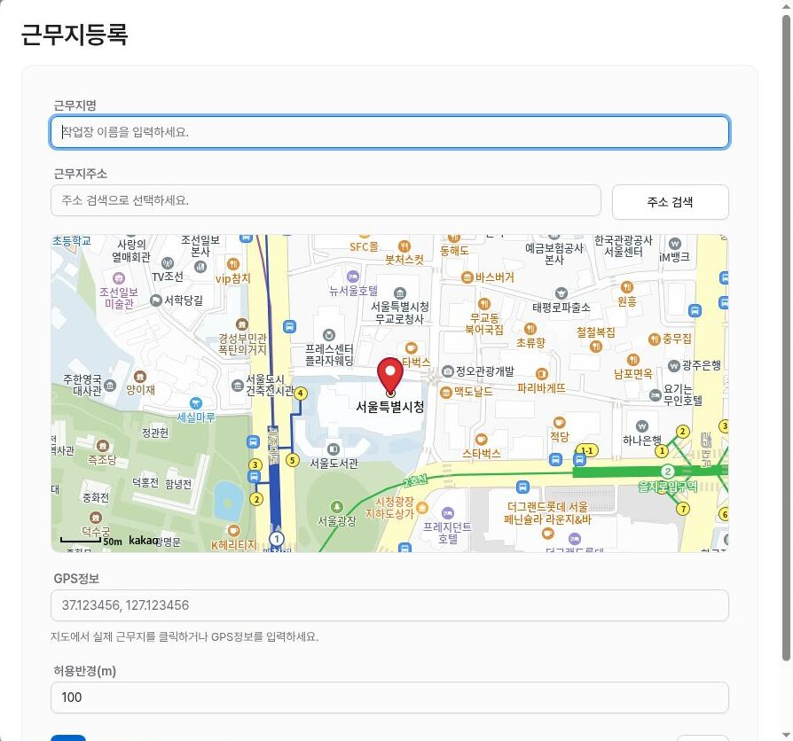

**근무지관리** 화면에서 **근무지 등록** 버튼을 누르면 열립니다.

| 항목 | 입력 또는 동작 |
| --- | --- |
| 근무지 이름 | 목록에 표시할 근무지 이름을 입력합니다. |
| 주소 검색 | 주소를 검색해 선택합니다. 선택한 주소의 위치 좌표가 함께 설정됩니다. |
| 허용반경 | 출퇴근을 허용할 거리 범위를 미터 단위로 입력합니다. |
| 현장등록 | 저장 완료 안내에서 새 근무지의 현장등록으로 이어갈 수 있습니다. |
| 저장 | 입력 내용을 확인하고 등록합니다. |
| 닫기 | 등록 창을 닫습니다. |

## 6. 근무지배정 {#manager-employee-assignments}

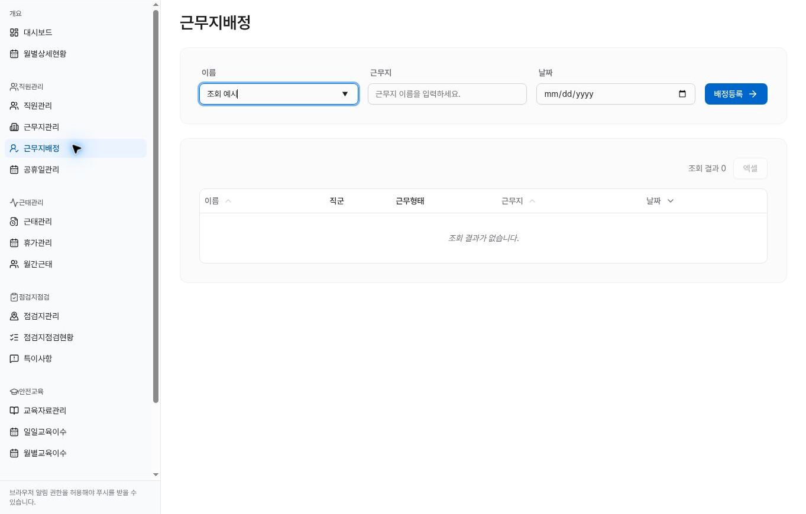

직원별 근무지 배정과 배정기간을 조회하고 새 배정을 등록하는 화면입니다.

### 조회 조건과 표시 내용

| 항목 | 설명 |
| --- | --- |
| 이름 | 직원 이름으로 목록을 좁힙니다. |
| 근무지 | 근무지 이름으로 목록을 좁힙니다. |
| 날짜 | 선택한 날짜가 배정기간에 포함되는 항목을 조회합니다. |
| 조회 결과 | 직원 이름, 직군, 근무형태, 근무지와 배정기간을 표시합니다. |

### 화면 링크

| 항목 | 기능 |
| --- | --- |
| 직원 이름 | 해당 직원의 근무지 배정 상세를 엽니다. |

### 버튼

| 버튼 | 기능 |
| --- | --- |
| [배정등록](#manager-assignment-register) | 새 근무지 배정 등록 창을 엽니다. |
| 정렬 화살표 | 이름, 근무지 또는 날짜를 기준으로 정렬 방향을 바꿉니다. |
| 엑셀 | 현재 조회 결과를 엑셀 파일로 내려받습니다. |

[근무지배정 화면 열기](https://ollbareun.vercel.app/manager/employee/assignments)

### 6-1. 배정등록 {#manager-assignment-register}

**근무지배정** 화면에서 **배정등록** 버튼을 누르면 열립니다.

| 항목 | 입력 또는 동작 |
| --- | --- |
| 이름·근무지 | 배정할 직원과 근무지를 선택합니다. |
| 근무기간 | 시작일과 종료일을 지정합니다. |
| 근무형태·출근·퇴근 | 배정 기간에 적용할 근무형태와 출퇴근 시각을 설정합니다. |
| 요일·공휴일별 설정 | 근무형태에 따라 휴무일과 요일별 근무 규칙을 설정합니다. |
| 기존 배정·출근 이력 | 선택 기간에 해당하는 이력이 있으면 아래 목록에서 확인합니다. 배정 기간이 겹치면 저장 과정에서 중복 안내를 확인합니다. |
| 배정등록 | 입력 내용을 확인하고 등록합니다. |
| 닫기 | 등록 창을 닫습니다. |

## 7. 공휴일관리 {#manager-employee-holidays}

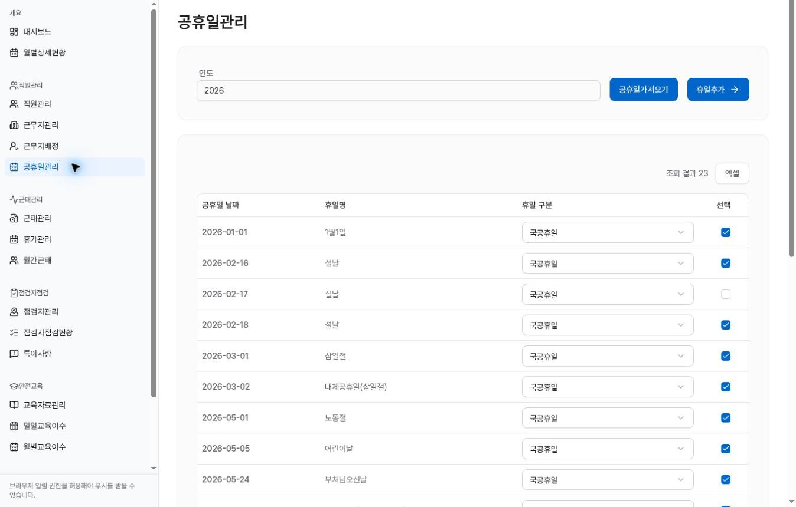

연도별 공휴일과 회사 지정 휴일을 조회하고 적용할 휴일을 관리하는 화면입니다.

### 조회 조건과 표시 내용

| 항목 | 설명 |
| --- | --- |
| 연도 | 조회할 연도를 입력합니다. |
| 조회 결과 | 공휴일 날짜, 휴일명, 휴일 구분과 선택 여부를 표시합니다. |

### 버튼과 조작

| 항목 | 기능 |
| --- | --- |
| 공휴일가져오기 | 확인 후 선택한 연도의 공휴일 정보를 가져옵니다. 이미 등록된 날짜는 건너뜁니다. |
| [휴일추가](#manager-holiday-register) | 새로운 휴일을 직접 등록하는 창을 엽니다. |
| 휴일 구분 | 국공휴일 또는 회사 지정 휴일로 변경합니다. |
| 선택 | 해당 날짜의 휴일 적용 여부를 바꿉니다. |
| 엑셀 | 현재 조회 결과를 엑셀 파일로 내려받습니다. |

[공휴일관리 화면 열기](https://ollbareun.vercel.app/manager/employee/holidays)

### 7-1. 휴일추가 {#manager-holiday-register}

**공휴일관리** 화면에서 **휴일추가** 버튼을 누르면 열립니다.

| 항목 | 입력 또는 동작 |
| --- | --- |
| 휴일명·날짜 | 목록에 표시할 이름과 휴일 날짜를 입력합니다. |
| 휴일 구분 | 회사 지정 휴일(휴무)과 국공휴일(직원별 공휴일 설정 적용) 중 선택합니다. |
| 휴일 적용 | 추가한 날짜는 휴일로 선택된 상태로 등록됩니다. |
| 저장 | 입력 내용을 확인하고 등록합니다. |
| 닫기 | 등록 창을 닫습니다. |

## 8. 근태관리 {#manager-reports-attendance}

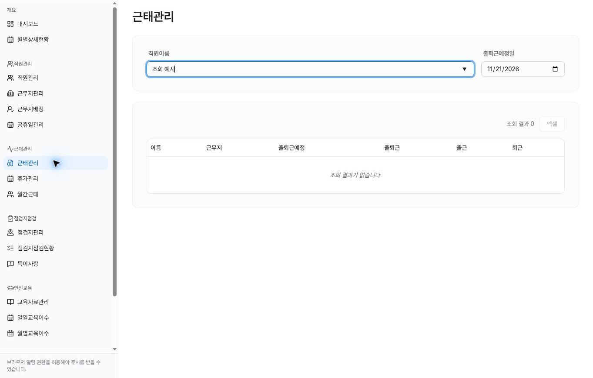

선택한 날짜의 예정·실제 출퇴근 기록과 출근·퇴근 상태를 확인하는 화면입니다.

### 조회 조건과 표시 내용

| 항목 | 설명 |
| --- | --- |
| 직원이름 | 직원 이름으로 목록을 좁힙니다. |
| 출퇴근예정일 | 조회할 근무 날짜를 선택합니다. |
| 조회 결과 | 직원 이름, 근무지, 예정·실제 출퇴근 시각과 출근·퇴근 상태를 표시합니다. |

### 화면 링크

| 항목 | 기능 |
| --- | --- |
| 직원 이름 | 해당 근태 기록의 상세를 엽니다. |

### 버튼

| 버튼 | 기능 |
| --- | --- |
| 엑셀 | 현재 조회 결과를 엑셀 파일로 내려받습니다. |

[근태관리 화면 열기](https://ollbareun.vercel.app/manager/reports/attendance)

## 9. 휴가관리 {#manager-leave}

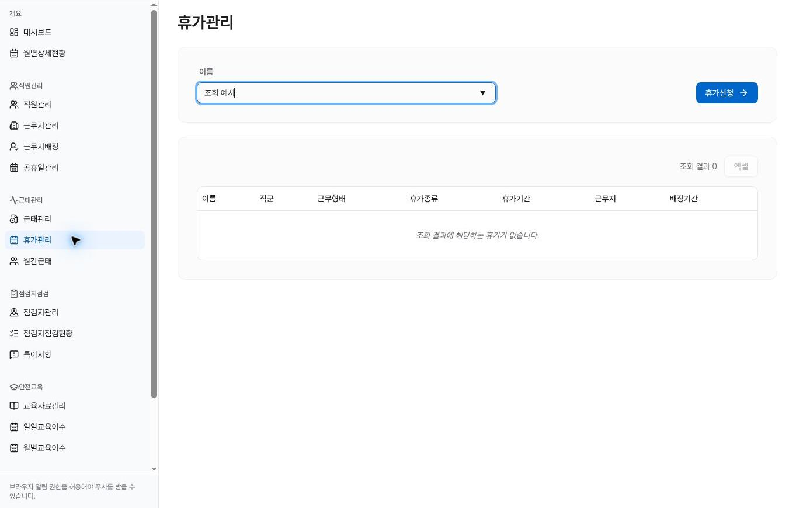

등록된 휴가 내역을 조회하고 직원의 휴가를 신청하는 화면입니다.

| 구분 | 항목 | 설명 |
| --- | --- | --- |
| 조회 조건 | 이름 | 직원 이름을 입력해 목록을 좁힙니다. |
| 표시 내용 | 조회 결과 | 이름, 직군, 근무형태, 휴가종류, 휴가기간, 근무지, 배정기간을 표시합니다. |
| 화면 링크 | 직원 이름 | 해당 휴가 기록의 상세를 엽니다. |
| 버튼 | [휴가신청](#manager-leave-register) | 휴가 등록 창을 엽니다. |
| 버튼 | 엑셀 | 현재 조회 결과를 엑셀 파일로 내려받습니다. |

[휴가관리 화면 열기](https://ollbareun.vercel.app/manager/leave)

### 9-1. 휴가신청 {#manager-leave-register}

**휴가관리** 화면에서 **휴가신청** 버튼을 누르면 열립니다.

| 항목 | 입력 또는 동작 |
| --- | --- |
| 직원·휴가종류 | 대상 직원과 등록된 휴가종류를 선택합니다. |
| 시작일·종료일 | 휴가 기간을 지정합니다. 이미 신청한 휴가 기간과 겹치면 안내가 표시됩니다. |
| 저장 | 입력 내용을 확인하고 등록합니다. |
| 닫기 | 등록 창을 닫습니다. |

## 10. 월간근태 {#manager-worker-information}

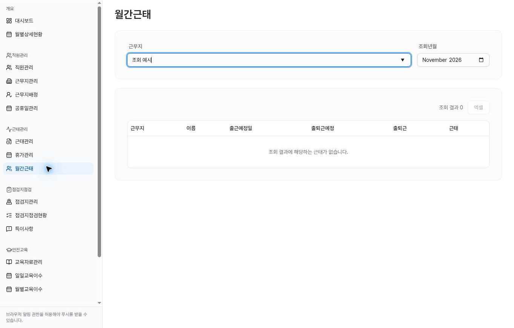

근무지별 직원의 한 달 출퇴근 기록을 조회하는 화면입니다.

| 구분 | 항목 | 설명 |
| --- | --- | --- |
| 조회 조건 | 근무지 | 근무지 이름으로 목록을 좁힙니다. |
| 조회 조건 | 조회년월 | 조회할 연도와 월을 선택합니다. |
| 표시 내용 | 조회 결과 | 근무지, 직원 이름, 출근예정일, 예정·실제 출퇴근 시각과 근태 상태를 표시합니다. |
| 화면 링크 | 출근예정일 | 해당 날짜의 근태 기록 상세를 엽니다. |
| 버튼 | 엑셀 | 현재 조회 결과를 엑셀 파일로 내려받습니다. |

[월간근태 화면 열기](https://ollbareun.vercel.app/manager/worker-information)

## 11. 점검지관리 {#manager-inspection-sites}

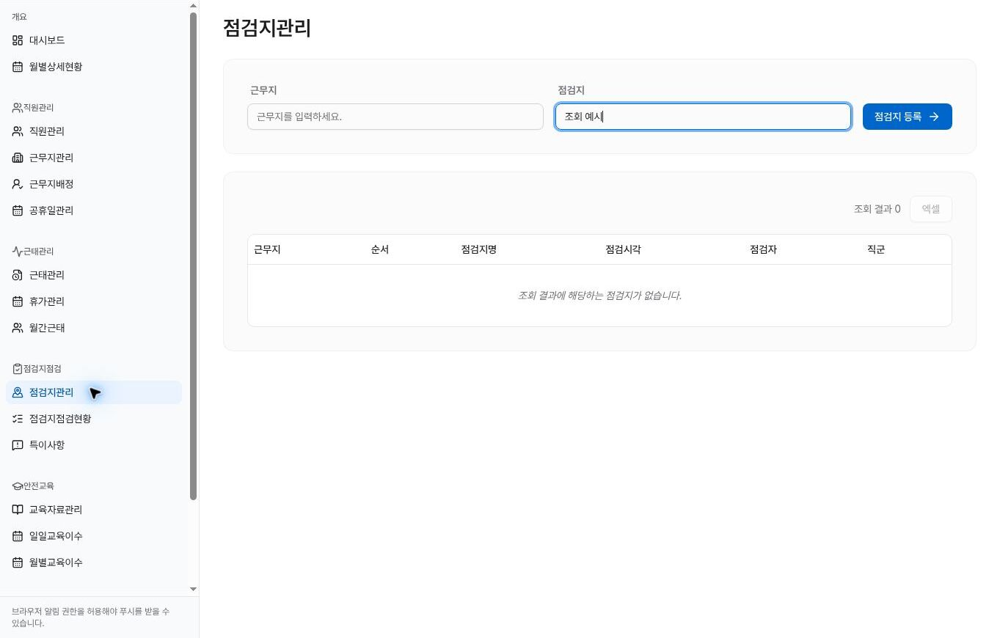

근무지에 등록된 점검지를 조회하고 새 점검지를 등록하는 화면입니다.

| 구분 | 항목 | 설명 |
| --- | --- | --- |
| 조회 조건 | 근무지, 점검지 | 근무지 이름이나 점검지 이름으로 목록을 좁힙니다. |
| 표시 내용 | 조회 결과 | 근무지, 점검 순서, 점검지명, 점검시각, 점검자와 직군을 표시합니다. |
| 화면 링크 | 점검지명 | 해당 점검지 상세를 엽니다. |
| 버튼 | [점검지 등록](#manager-inspection-register) | 새 점검지 등록 창을 엽니다. |
| 버튼 | 엑셀 | 현재 조회 결과를 엑셀 파일로 내려받습니다. |

[점검지관리 화면 열기](https://ollbareun.vercel.app/manager/inspection/sites)

### 11-1. 점검지 등록 {#manager-inspection-register}

**점검지관리** 화면에서 **점검지 등록** 버튼을 누르면 열립니다.

| 항목 | 입력 또는 동작 |
| --- | --- |
| 근무지 | 점검지를 등록할 근무지를 선택합니다. |
| 점검지명 | 목록에 표시할 점검지 이름을 입력합니다. |
| 저장 | 입력 내용을 확인하고 등록합니다. |
| 닫기 | 등록 창을 닫습니다. |

## 12. 점검지점검현황 {#manager-inspection-logs}

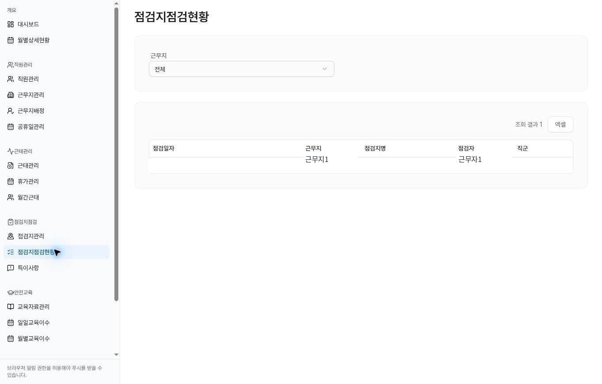

근무지별로 기록된 점검 이력을 조회하는 화면입니다.

| 구분 | 항목 | 설명 |
| --- | --- | --- |
| 조회 조건 | 근무지 | 특정 근무지를 선택하거나 전체를 조회합니다. |
| 표시 내용 | 조회 결과 | 점검일자, 근무지, 점검지명, 점검자와 직군을 표시합니다. |
| 버튼 | 엑셀 | 현재 조회 결과를 엑셀 파일로 내려받습니다. |

[점검지점검현황 화면 열기](https://ollbareun.vercel.app/manager/inspection/logs)

## 13. 특이사항 {#manager-inspection-special-remarks}

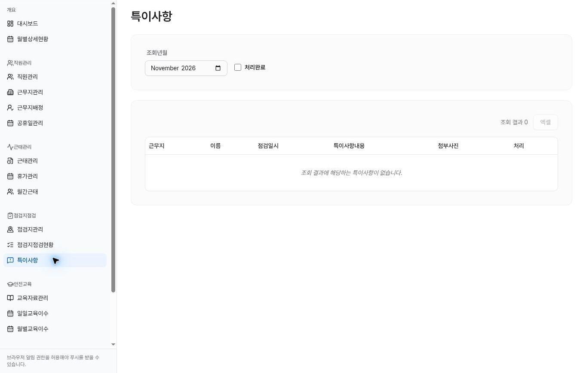

근무 중 보고된 특이사항과 처리 상태를 확인하는 화면입니다.

| 구분 | 항목 | 설명 |
| --- | --- | --- |
| 조회 조건 | 조회년월, 처리완료 | 조회할 월과 처리 상태를 선택합니다. |
| 표시 내용 | 조회 결과 | 근무지, 보고자, 점검일시, 내용, 첨부사진과 처리 상태를 표시합니다. |
| 화면 링크 | 점검일시 | 보고 상세에서 전체 내용과 사진을 확인하고 미처리 건을 처리완료로 바꿀 수 있습니다. |
| 버튼 | 엑셀 | 현재 조회 결과를 엑셀 파일로 내려받습니다. |

[특이사항 화면 열기](https://ollbareun.vercel.app/manager/inspection/special-remarks)

## 14. 교육자료관리 {#manager-safety-resources}

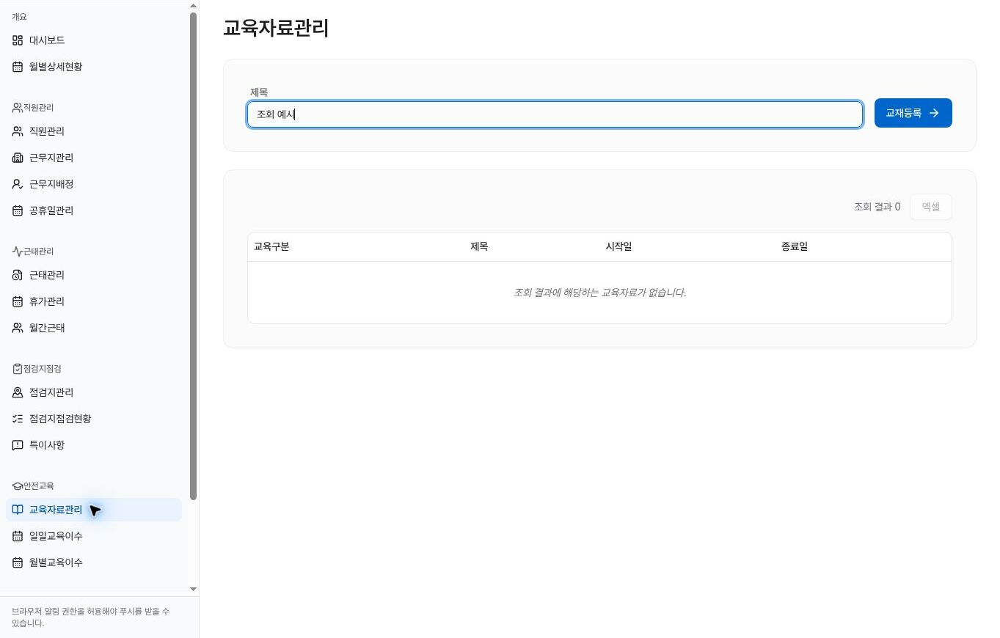

안전교육에 사용할 교재와 적용 기간을 관리하는 화면입니다.

| 구분 | 항목 | 설명 |
| --- | --- | --- |
| 조회 조건 | 제목 | 교육자료 제목을 입력해 목록을 좁힙니다. |
| 표시 내용 | 조회 결과 | 교육구분, 제목, 시작일과 종료일을 표시합니다. |
| 화면 링크 | 제목 | 선택한 교육자료 상세를 엽니다. |
| 버튼 | [교재등록](#manager-resource-register) | 신규 교육자료 등록 창을 엽니다. |
| 버튼 | 엑셀 | 현재 조회 결과를 엑셀 파일로 내려받습니다. |

[교육자료관리 화면 열기](https://ollbareun.vercel.app/manager/safety/resources)

### 14-1. 교재등록 {#manager-resource-register}

**교육자료관리** 화면에서 **교재등록** 버튼을 누르면 열립니다.

| 항목 | 입력 또는 동작 |
| --- | --- |
| 교육구분 | 일일, 월별, 분기, 반기, 연간 중 교육 주기를 선택합니다. |
| 시작일·종료일 | 교재 적용 기간을 지정합니다. |
| 제목 | 교육자료 제목을 입력합니다. |
| 유튜브 링크 | 근무자가 시청할 유튜브 영상 주소를 입력합니다. |
| 저장 | 입력 내용을 확인하고 등록합니다. |
| 닫기 | 등록 창을 닫습니다. |

## 15. 일일교육이수 {#manager-safety-daily-edu}

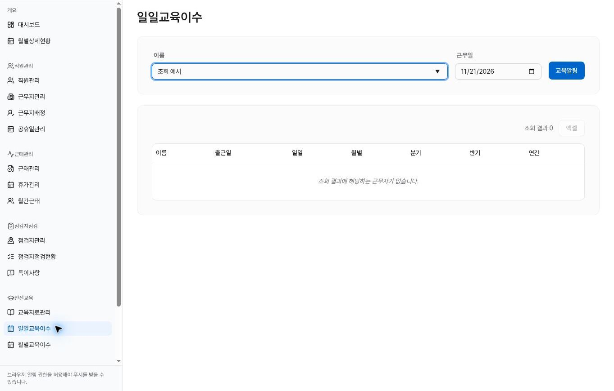

근무일별 안전교육 이수 여부를 확인하는 화면입니다.

| 구분 | 항목 | 설명 |
| --- | --- | --- |
| 조회 조건 | 이름, 근무일 | 직원 이름과 조회할 근무일을 지정합니다. |
| 표시 내용 | 조회 결과 | 직원 이름, 출근일, 일일·월별·분기·반기·연간 교육 이수 여부를 표시합니다. |
| 버튼 | 교육알림 | 오늘 근무일로 조회한 목록에서 미이수자에게 알림을 보낼지 확인하는 창을 엽니다. |
| 버튼 | 엑셀 | 현재 조회 결과를 엑셀 파일로 내려받습니다. |

[일일교육이수 화면 열기](https://ollbareun.vercel.app/manager/safety/daily_edu)

## 16. 월별교육이수 {#manager-safety-monthly-edu}

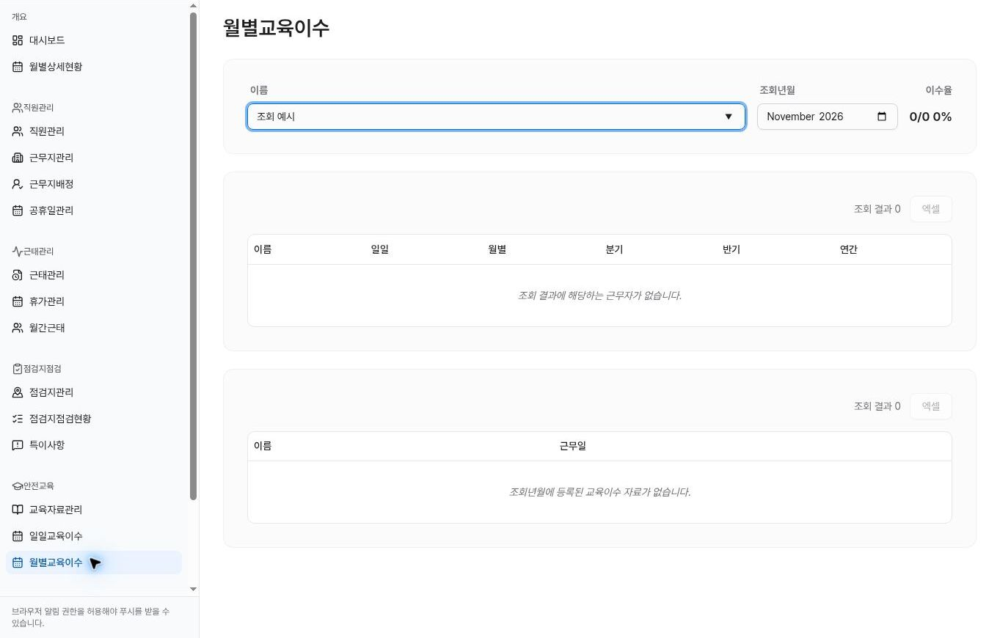

월별 안전교육 이수 요약과 일일교육 기록을 함께 확인하는 화면입니다.

| 구분 | 항목 | 설명 |
| --- | --- | --- |
| 조회 조건 | 이름, 조회년월 | 직원 이름과 조회할 연도·월을 지정합니다. |
| 표시 내용 | 월별 이수 요약 | 직원별 일일교육 이수 건수와 월별·분기·반기·연간 교육 이수 여부를 표시합니다. |
| 표시 내용 | 일일교육 기록 | 직원별 근무일과 교재별 이수 여부를 표시합니다. |
| 버튼과 조작 | 미이수 표시 | 조작 가능한 미이수 표시를 누르면 해당 기록을 이수 처리하는 확인 창을 엽니다. |
| 버튼 | 엑셀 | 각 표의 조회 결과를 별도로 내려받습니다. |

[월별교육이수 화면 열기](https://ollbareun.vercel.app/manager/safety/monthly_edu)

## 17. 관리자관리 {#manager-system-admin-users}

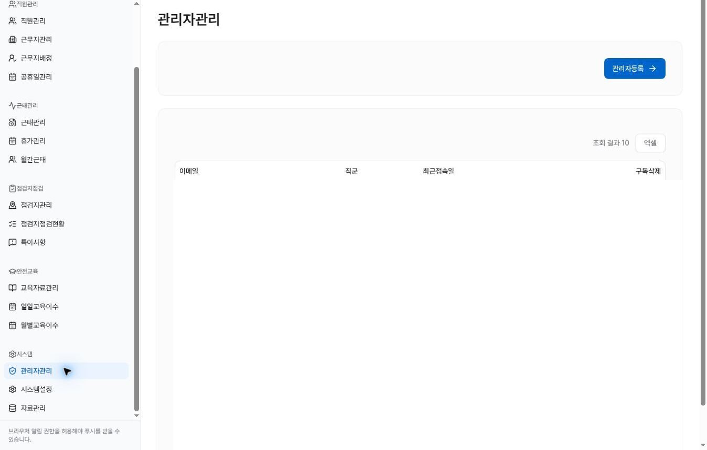

관리자 계정과 푸시 알림 구독을 관리하는 화면입니다. 공개 캡처에서는 계정 행을 가렸습니다.

| 구분 | 항목 | 설명 |
| --- | --- | --- |
| 표시 내용 | 관리자 목록 | 등록된 관리자의 이메일, 직군, 최근접속일과 구독 삭제 항목을 표시합니다. |
| 화면 링크 | 이메일 | 해당 관리자 계정의 상세를 엽니다. |
| 버튼 | [관리자등록](#manager-admin-register) | 신규 관리자 등록 창을 엽니다. |
| 버튼 | 삭제 | 권한이 있는 관리자가 해당 기기의 알림 구독을 삭제합니다. |
| 버튼 | 엑셀 | 관리자 목록을 엑셀 파일로 내려받습니다. |

[관리자관리 화면 열기](https://ollbareun.vercel.app/manager/system/admin-users)

### 17-1. 관리자등록 {#manager-admin-register}

**관리자관리** 화면에서 **관리자등록** 버튼을 누르면 열립니다.

| 항목 | 입력 또는 동작 |
| --- | --- |
| 관리자이메일 | 관리자 인증에 사용할 Google 계정 이메일을 입력합니다. |
| 직군 설정 | 일반 관리자 또는 최고 관리자를 선택합니다. |
| 저장 | 입력 내용을 확인하고 등록합니다. |
| 닫기 | 등록 창을 닫습니다. |

## 18. 시스템설정 {#manager-system-configs}

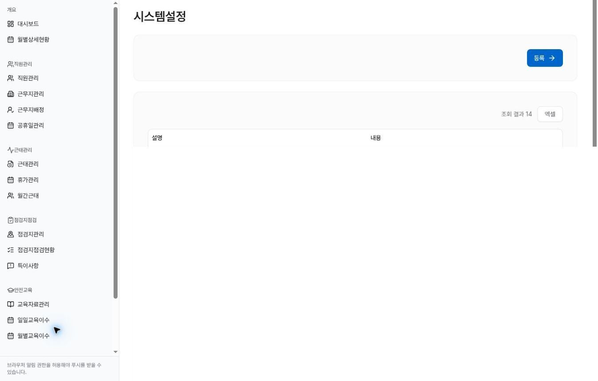

시스템 설정을 조회하고 등록하는 화면입니다. 공개 캡처에서는 개별 설정값을 가렸습니다.

| 구분 | 항목 | 설명 |
| --- | --- | --- |
| 표시 내용 | 설정 목록 | 등록된 설정의 설명과 내용을 표시합니다. |
| 화면 링크 | 설명 | 해당 시스템 설정 상세를 엽니다. |
| 버튼 | [등록](#manager-config-register) | 새 설정 등록 창을 엽니다. |
| 버튼 | 엑셀 | 현재 설정 목록을 엑셀 파일로 내려받습니다. |

[시스템설정 화면 열기](https://ollbareun.vercel.app/manager/system/configs)

### 18-1. 시스템설정 등록 {#manager-config-register}

**시스템설정** 화면에서 **등록** 버튼을 누르면 열립니다.

| 항목 | 입력 또는 동작 |
| --- | --- |
| 설명 | 설정의 용도나 이름을 입력합니다. |
| 내용 | 새 설정에 사용할 값을 입력합니다. |
| 저장 | 입력 내용을 확인하고 등록합니다. |
| 닫기 | 등록 창을 닫습니다. |

## 19. 자료관리 {#manager-system-data-manage}

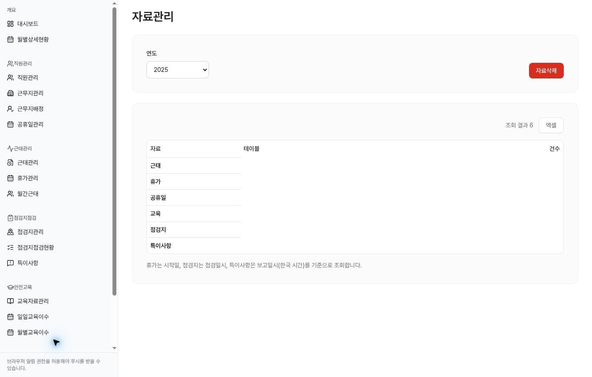

연도별 자료를 조회하고 선택한 연도의 자료를 정리하는 화면입니다.

| 구분 | 항목 | 설명 |
| --- | --- | --- |
| 조회 조건 | 연도 | 조회할 자료의 연도를 선택합니다. |
| 표시 내용 | 조회 결과 | 근태, 휴가, 공휴일, 교육, 점검지, 특이사항의 테이블과 건수를 표시합니다. |
| 버튼 | 자료삭제 | 선택한 연도의 자료를 삭제하는 두 단계 확인 창을 엽니다. 삭제한 자료는 복구할 수 없습니다. |
| 버튼 | 다시 조회 | 조회 오류가 발생했을 때 다시 불러옵니다. |
| 버튼 | 엑셀 | 조회 결과를 엑셀 파일로 내려받습니다. |

[자료관리 화면 열기](https://ollbareun.vercel.app/manager/system/data-manage)
