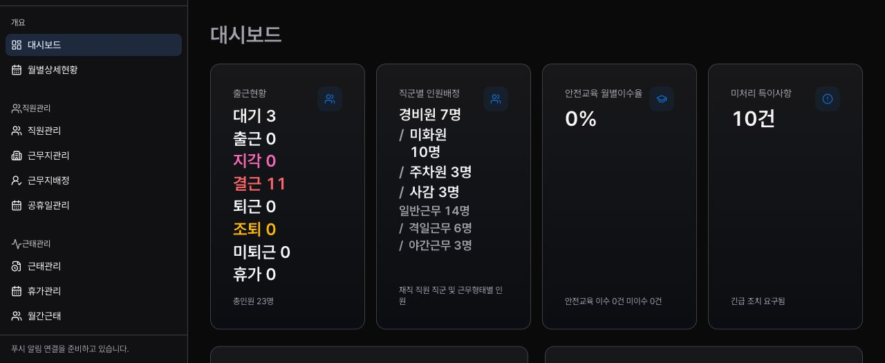

# 화면설명서

## 목차

1. [관리자인증](#manager-auth)
2. [관리자 메인 화면](#manager-dashboard)

## 1. 관리자인증 {#manager-auth}

관리자 페이지에 들어가기 전에 Google 계정으로 본인 확인을 하는 화면입니다. 관리자 권한이 등록된 Google 계정으로 인증하면 관리자 메인 화면으로 이동합니다. 등록되지 않은 계정으로 인증하면 관리자 권한이 없다는 안내가 표시됩니다.

| 버튼 | 기능 |
| --- | --- |
| Google로 관리자 로그인 | Google 로그인으로 이동합니다. 관리자 권한이 등록된 Google 계정을 선택해 인증합니다. |
| 설치 | 하단에 **올바름 관리자 설치** 안내가 표시될 때 사용할 수 있습니다. 브라우저의 설치 확인창을 열어 관리자 앱 아이콘을 기기에 추가할 수 있습니다. |

[관리자 인증 화면 열기](https://www.olbareum.com/manager/auth?next=%2Fmanager)

## 2. 관리자 메인 화면 {#manager-dashboard}

관리자 로그인 후 처음 표시되는 대시보드입니다. 출퇴근, 재직 인원, 안전교육, 특이사항과 휴가·점검 현황을 한눈에 확인할 수 있습니다. 캡처는 운영 요약과 왼쪽 메뉴 일부를 보여 줍니다. 화면에 표시된 수치는 테스트 데이터입니다.

### 조회 기준과 표시 내용

조회 조건을 입력할 필요 없이 화면을 열면 자동으로 현황을 불러옵니다.

| 항목 | 표시 내용 |
| --- | --- |
| 출근현황 | 오늘의 대기, 출근, 지각, 결근, 퇴근, 조퇴, 미퇴근, 휴가 인원과 총인원 |
| 직군별 인원배정 | 재직 직원의 직군별 인원과 일반·격일·야간 근무형태별 인원 |
| 안전교육 월별이수율 | 이번 달 안전교육 이수율과 이수·미이수 건수 |
| 미처리 특이사항 | 아직 처리되지 않은 특이사항 건수 |
| 금주 휴가현황 | 이번 주 휴가 일정의 이름, 직군, 근무형태, 휴가종류, 휴가기간, 근무지, 배정기간 |
| 점검지 점검 현황 | 근무지별 출근 인원/배정 인원과 전체 점검지 중 점검을 마친 비율 |

### 화면 링크

| 클릭하는 항목 | 이동하는 화면 |
| --- | --- |
| 출근현황 카드 | 근태관리 |
| 직군별 인원배정 카드 | 직원관리 |
| 안전교육 월별이수율 카드 | 월별교육이수 |
| 미처리 특이사항 카드 | 특이사항 |
| 금주 휴가현황의 전체보기 또는 직원 이름 | 휴가관리 |
| 점검지 점검 현황의 근무지명 | 점검지관리 |
| 왼쪽 메뉴 | 개요, 직원관리, 근태관리, 점검지점검, 안전교육, 시스템의 각 업무 화면 |

### 버튼

| 버튼 | 기능 |
| --- | --- |
| 관리자 메뉴 열기 또는 접기 / 관리자 사이드바 접기 또는 펼치기 | 왼쪽 관리자 메뉴를 열거나 접습니다. |
| 사용자 메뉴 | 화면 오른쪽 위의 계정 아이콘을 누르면 **로그아웃** 항목이 열립니다. |
| 로그아웃 | 현재 관리자 세션을 종료합니다. |

[관리자 메인 화면 열기](https://ollbareun.vercel.app/manager)
